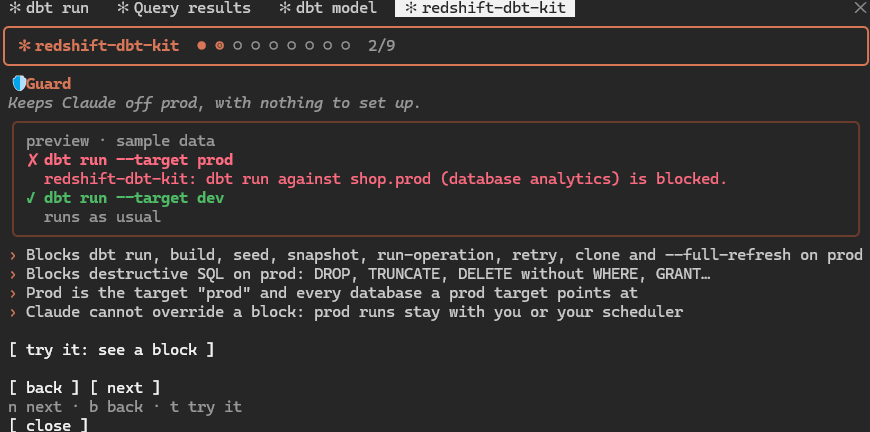
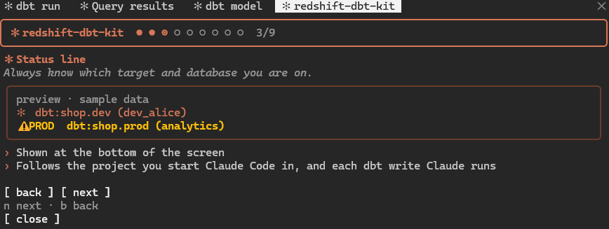
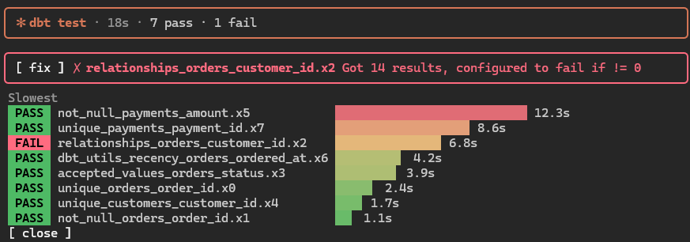
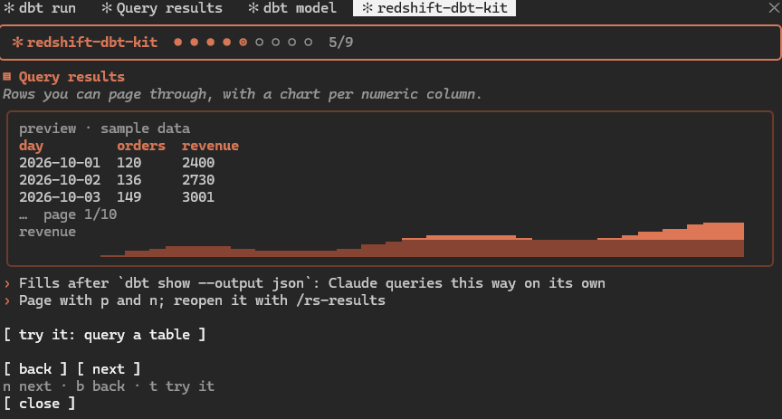
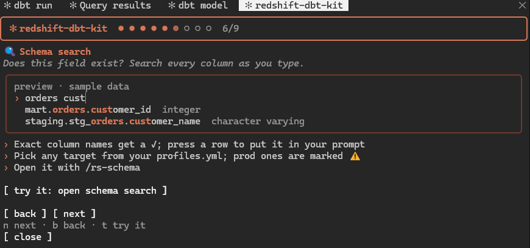
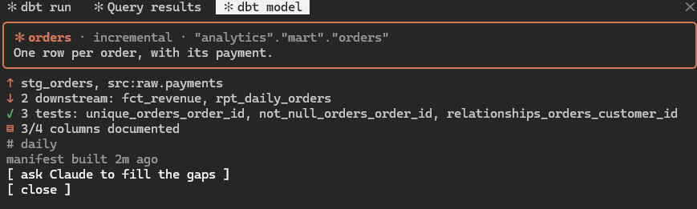
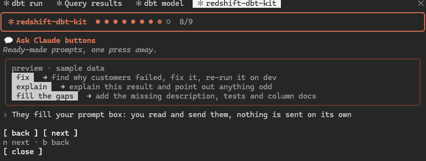
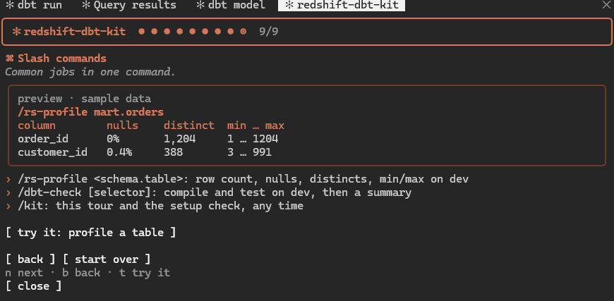

# redshift-dbt-kit

**Redshift + dbt tools for Claude Code.** See your dbt runs, query results, columns and models in panes beside the chat, and keep Claude's writes off prod.

```
claude plugin install redshift-dbt-kit --marketplace rBingz/redshift-dbt-kit --scope user
```

Then restart Claude Code. On the first start, a short tour opens: it checks your setup and shows each feature, with a "try it" button for each. Run `/kit` to see it again. Most teams need no settings. See [Install](#install) for other ways.

---

## What you get

| | Feature | What it does | Open with |
| --- | --- | --- | --- |
| 🛡 | [Guard](#guard) | Blocks dbt writes and destructive SQL on prod | always on |
| ✻ | [Status line](#status-line) | Shows the live dbt target and database | always on |
| ▦ | [dbt run board](#dbt-run-board) | Results of each dbt run: failures, slowest models | `/dbt-board` |
| ▤ | [Query results](#query-results) | Rows of `dbt show` as a table, with charts | `/rs-results` |
| 🔍 | [Schema browser](#schema-browser) | Search every column: does this field exist? | `/rs-schema` |
| ◈ | [Model card](#model-card) | A model's lineage, tests and docs | `/dbt-model` |
| 💬 | [Ask Claude buttons](#ask-claude-buttons) | Ready-made prompts from the panes | in the panes |
| ⌘ | [Slash commands](#slash-commands) | Profile a table, check models on dev | `/rs-profile`, `/dbt-check` |
| 🧭 | [Setup check and tour](#setup-check-and-tour) | Checks your setup, then walks through each feature | `/kit` |

Panes open on their own when the terminal is wide enough. Otherwise, open them with the command.

---

## Guard

Checks every command Claude runs in Bash or PowerShell, before it runs.



**What counts as prod:** a target named `prod`, **and the database it points at.** Any other target on that database is prod too, whatever it is called, with nothing to set. Add more databases with the [`prodDatabases`](#configure) setting.

| On prod, it blocks | It never blocks |
| --- | --- |
| `dbt run`, `build`, `seed`, `snapshot`, `run-operation`, `retry`, `clone` | `dbt compile`, `test`, `ls`, `docs` |
| `--full-refresh` | `dbt show` with read-only SQL |
| `DROP`, `TRUNCATE`, `ALTER TABLE ... DROP`, `GRANT`, `REVOKE` | `DELETE` and `UPDATE` with a `WHERE` |
| `DELETE` / `UPDATE` without `WHERE` | anything on a dev database |

On any target, it also blocks `dbt show --limit` above 1,000, or `-1` (no limit): a huge result is slow on Redshift and on your machine.

The SQL check covers `dbt show --inline`, `aws redshift-data` and `psql`: inline, in SQL files, or sent to `psql` with `<`. Destructive SQL with no database named is blocked too.

**How it knows the target:** dbt itself resolves it, so any `profiles.yml` dbt accepts works: Jinja, `env_var()`, YAML anchors and merges, and every place dbt looks for the file. If dbt cannot resolve it, the write is blocked with dbt's error.

**What it reads in a command:**
- chained calls: `&&`, `;`, `|`, new lines
- subshells: `$(...)`, backticks, parentheses
- flags before the dbt command
- `cd` and `Set-Location`
- `DBT_TARGET`, `DBT_PROFILE`, `DBT_PROFILES_DIR`, `DBT_PROJECT_DIR` and `DBT_FULL_REFRESH`, set inline, with `export`, or with `$env:`

> [!WARNING]
> The guard is a seatbelt, not a permission system. Some commands will always slip past (see [Limits](#limits)). Keep real prod rights in database grants: see [Give dev its own login](#tip-give-dev-its-own-login).

## Status line

Shows the live dbt target and its database, with a warning on prod.



## dbt run board

Opens with a spinner while dbt runs. After each `dbt run`, `build`, `test`, `seed` or `snapshot`, it shows:
- counts by status
- failures, with their messages
- the slowest models, with status chips and bars colored green to red by run time



It reads `target/run_results.json`. A toast tells you when a run took longer than [`toastSeconds`](#configure).

## Query results

After `dbt show --output json` (or `aws redshift-data get-statement-result`), it shows:
- the rows as a table; page with `p` and `n`
- a small area chart per numeric column, in row order (a sparkline outside the terminal). Only when the query ends in `ORDER BY`: unsorted rows have no order worth charting.



It keeps the first 1,000 rows. dbt's own `--limit` keeps the query small: dbt adds it to the SQL, so Redshift sends only that many rows. The guard blocks a `--limit` over 1,000.

## Schema browser

1. **Pick a target:** any `profile.target` from your `profiles.yml`. Prod ones are marked ⚠.
2. **Search as you type**, e.g. `orders cust`. Exact column names get a ✓. "No column matches" tells you a field does not exist.
3. **Press a row** to put `schema.table.column` in your prompt.



Columns come from `svv_columns`, read through `dbt show` with your own dbt login. They are cached per target across sessions; press refresh to reload.

## Model card

When Claude reads or edits `models/**/*.sql`, the card shows the model's:
- materialization and relation
- description
- upstream and downstream models
- tests, documented columns and last run



It reads `target/manifest.json`; run `dbt parse` to refresh it.

> [!NOTE]
> A mod can read files of 4 MiB at most. For a bigger `manifest.json`, a small Python script (`runner/model_card.py`) reads it and hands back only that model's part. It uses `python3`, `python` or `py`, whichever works.

## Ask Claude buttons

They put a prompt in your prompt box for you to read and send. Nothing is sent on its own.



| Button | Where | Asks Claude to |
| --- | --- | --- |
| `fix` | each failed model or test on the run board | find the cause and fix it on dev |
| `explain` (`e`) | query results | explain the result and point out anything odd |
| ask Claude to fill the gaps | a model card missing docs or tests | add the description, tests or column docs |

## Slash commands

| Command | Does |
| --- | --- |
| `/rs-profile <schema.table>` | Profiles a table on a dev target: row count, nulls, distincts, min/max |
| `/dbt-check [selector]` | Compiles and tests models on dev, then summarizes failures |
| `/kit` | The setup check and the tour |



## Setup check and tour

Opens on its own the first time, and with `/kit` any time after.

**Page 1 checks your setup.** Each line is ✓, ⚠ or ✗, and anything not ✓ says how to fix it:

| Check | Looks at |
| --- | --- |
| dbt | `dbt --version` works |
| profiles.yml | where dbt finds it, and how many profiles and targets it has |
| dbt project | whether Claude Code started in a dbt project |
| prod | the prod databases, and every target that points at one |
| logins | whether a dev target logs in as the same user as prod |
| Python | only needed when `manifest.json` is over 4 MiB |

**The next pages show one feature each**, with a preview of its pane drawn from sample data, and a "try it" button that puts a ready-made prompt in your prompt box. They use the dev target the check found, and nothing touches prod: the guard's demo is an `echo`. Move with `n` (next) and `b` (back); `t` presses try it, and `r` reruns the check.

## Team conventions

The mod adds a short section to Claude's system prompt. It tells Claude to:
- query through `dbt show --output json` on a dev target, without piping the output, so the results pane fills
- pass `--target` on every dbt command
- treat the prod databases from your settings as prod
- not work around a block

---

## Install

**You need:**
- Claude Code, in a terminal
- `dbt` on your PATH, with your `profiles.yml` in `~/.dbt`, `$DBT_PROFILES_DIR` or the project folder
- Python 3 (`python3`, `python` or `py`), only if your `target/manifest.json` is over 4 MiB

**From GitHub:**

```
claude plugin install redshift-dbt-kit --marketplace rBingz/redshift-dbt-kit --scope user
```

If the repo is private, you need read access to it, and `gh auth login` done first.

**From a folder:** to share it privately, copy this whole folder somewhere your team can read, such as a team repo. Then each person runs:

```
claude plugin install redshift-dbt-kit --marketplace <path to the copied folder> --scope user
```

Restart Claude Code afterwards.

> [!NOTE]
> The install says 3 settings are not set yet. That is fine: each has a working default.

## Update

| Installed from | To update |
| --- | --- |
| GitHub | `claude plugin marketplace update redshift-dbt-kit`, then restart Claude Code |
| A folder | Pull or copy the new files into the folder, then restart Claude Code |

Run `claude plugin list` to see your version.

## Configure

In Claude Code, run `/plugin configure redshift-dbt-kit@redshift-dbt-kit`.

| Setting | Default | Meaning |
| --- | --- | --- |
| `prodDatabases` | (none) | More databases treated as prod, comma-separated, beyond those your `prod` targets point at |
| `prodDbtTarget` | `prod` | The target name treated as prod |
| `toastSeconds` | `60` | Toast when a dbt run takes at least this long |

**Most teams need no settings.** The mod warns you when it does need one:
- **No prod target and no setting:** if no profile has a `prod` target and `prodDatabases` is empty, it knows no prod database, and says so at session start.
- **A prod target it can't resolve:** for example, the prod password is an `env_var` only CI sets. It says so once, naming the target. Set `prodDatabases` then.

## Tip: give dev its own login

> [!TIP]
> Claude runs with your login, so whatever that login can do, Claude can do. The real lock is the database's own grants.
>
> - Give each person a dev login (the `user` in their dev target) with no write rights on the prod database.
> - Keep prod logins for deploys, and for the people who run them.

When a dbt write runs on a dev target that logs in as the same user as a `prod` target, the mod shows this tip once, naming both targets.

## Report a problem

Open an issue on the repo, or tell whoever shared the mod with you. Include:
- for a wrong block or a miss: the exact command and the mod's message
- for an empty pane: the command that should have filled it
- your OS and `dbt --version`

## Limits

<details>
<summary><b>What the guard cannot see</b></summary>

- The SQL check is a regex scan, not a parser. A script that hides SQL (`bash run.sh`), a GUI client, or SQL built at run time slips past.
- `bash -c "..."`, `powershell -Command "..."`, `make`, scripts and aliases are not read: the command inside is quoted or in another file.
- Quoted text is not read as a command, except `$(...)` and backticks inside double quotes, which the shell runs.
- Each line of a heredoc body is read as a command, so a dbt write written there is checked as if it ran.

</details>

<details>
<summary><b>When the guard plays it safe</b></summary>

- It finds a command's profile from `--profile`, or from the `dbt_project.yml` it runs in. When it cannot, it checks every profile with that target name, and prod wins: `dbt run --target dev` outside a project is blocked if any profile's `dev` points at a prod database.
- After `popd`, it cannot tell the folder, so it checks every profile, and prod wins.

</details>

<details>
<summary><b>Speed</b></summary>

- The first dbt write per target waits for dbt to start and resolve the target: about 8 seconds on Windows.
- The answer is kept until `profiles.yml` changes. An environment variable that `profiles.yml` reads takes effect in the next session.
- Reads (`dbt test`, `ls`, `compile`, `show` with a SELECT) never wait.

</details>

<details>
<summary><b>Panes</b></summary>

- Panes open on their own only when the terminal is wide enough (about 110–144 columns).
- The results pane keeps the first 1,000 rows.
- The schema browser keeps only the newest target's columns between sessions: the shared store holds 4 MiB.
- The schema browser refuses a catalog over 4 MiB of output.
- The schema picker lists targets written in block-style YAML. Targets written in flow style (`outputs: {dev: ...}`) or as an alias do not show in the picker; the guard still covers them.

</details>

## Develop

```
claude plugin validate .
claude plugin test .
```

## License

MIT. See [LICENSE](LICENSE).
